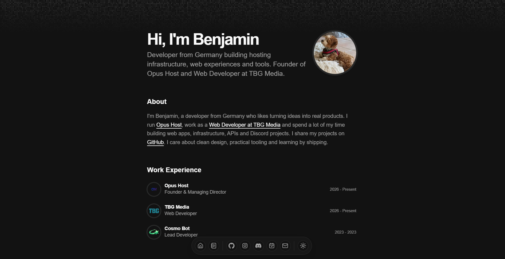

# Benjamin Blanke

**Personal Portfolio · Developer · Creator**

 

*A personal space on the internet.*

 

 

[**Visit Website ↗**](https://blanke.lol)

---

## About

I'm Benjamin Oliver Blanke, a developer from Germany with a passion for building digital experiences, exploring infrastructure, and turning ideas into real projects.

**blanke.lol** is my personal corner of the internet — a place to showcase my work, interests, and projects in one carefully designed experience.

## ✦ What defines it

<table>
<tr>
<td width="50%" valign="top">

### ◈ Minimal by design

A dark aesthetic, clean typography, and intentional use of space.

</td>
<td width="50%" valign="top">

### ◈ Built to feel right

A responsive experience designed for desktop and mobile.

</td>
</tr>
<tr>
<td width="50%" valign="top">

### ◈ Personal identity

One place for my projects, work, and online presence.

</td>
<td width="50%" valign="top">

### ◈ Always evolving

Continuously refined with new ideas, improvements, and details.

</td>
</tr>
</table>

## ⚙ Tech Stack

## ↗ Find me online

---

**Simple on the surface. Carefully built underneath.**

 

▲ Hosted, made and maintained by Benjamin.

 

[blanke.lol](https://blanke.lol)

